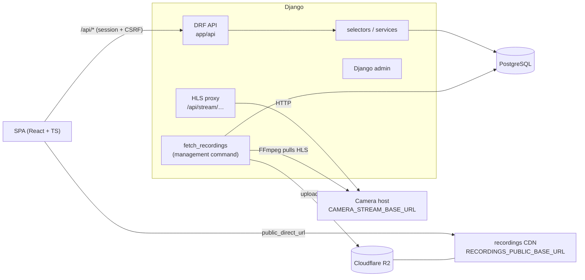

# DidiCameras

A Django REST API for monitoring security cameras: it proxies live HLS streams, records clips with FFmpeg, stores them in Cloudflare R2 (S3-compatible), and exposes cameras, recordings and recording settings over a session-authenticated JSON API. A React + TypeScript SPA (`frontend/`) is the UI; Django serves it alongside the API.

Originally built for the *Cloud, IoT e Indústria 4.0 em Python* course.

## Architecture



| Path | What it is |
|---|---|
| `app/api/` | DRF serializers, views and routes |
| `app/selectors.py` | Read-side query helpers (recording filters) |
| `app/services/storage.py` | R2/S3 client and public URL mapping |
| `app/management/commands/fetch_recordings.py` | Records a clip from every camera in parallel and uploads it |
| `DidiCameras/settings/` | `base`, `dev`, `prod`, `test` settings |
| `frontend/` | React + TypeScript SPA (Vite); see [`frontend/README.md`](frontend/README.md) |

## API

Interactive docs are served at **`/api/schema/swagger-ui/`**, and the raw OpenAPI schema is at `/api/schema/`.

| Endpoint | Description |
|---|---|
| `GET /api/cameras/` | Cameras with location, live URL and active flag |
| `GET /api/recordings/?date=YYYY-MM-DD&search=&camera=` | Paginated recordings, newest first |
| `GET /api/recordings/{id}/` | Single recording |
| `GET`, `PATCH /api/config/`, `POST /api/config/reset/` | FFmpeg recording config (singleton) |
| `GET /api/auth/csrf/`, `POST /api/auth/login/`, `POST /api/auth/logout/`, `GET /api/auth/me/` | Session auth |
| `GET /api/stream/{camera}/{path}` | Authenticated HLS proxy to the camera host |
| `GET /api/health/[?cameras=1]` | Uptime check (database, optionally the camera host) |

Every endpoint except `csrf`, `login` and `health` requires a logged-in session. To log in, the SPA calls `GET /api/auth/csrf/`, then sends the token as `X-CSRFToken` on `POST`, `PATCH` and `DELETE` requests.

## Local development

You need [uv](https://docs.astral.sh/uv/), and FFmpeg if you want to run `fetch_recordings`.

```bash
git clone https://github.com/GabrielaPeroni/DidiCameras.git
cd DidiCameras
uv sync                      # creates .venv with runtime + dev dependencies
cp .env.example .env         # optional in dev; without DATABASE_URL a local SQLite db is used
uv run pre-commit install
uv run python manage.py migrate
uv run python manage.py createsuperuser
uv run python manage.py runserver
```

`manage.py` uses `DidiCameras.settings.dev`, WSGI and Docker use `prod`, and pytest uses `test`.

### Frontend

With Django running on `:8000`, start the Vite dev server in a second terminal (Node 22+):

```bash
cd frontend
npm install
npm run dev                  # http://localhost:5173, proxies /api to Django
```

Log in at `http://localhost:5173/login` with the superuser you created. To try the production setup instead, run `npm run build`. Django then serves the built SPA at `http://localhost:8000/`, and any non-API path returns `frontend/dist/index.html`.

### Running without cameras (mock mode)

`docker-compose.mock.yml` runs the whole app with fake cameras and fake storage, so you need only Docker:

```bash
docker compose -f docker-compose.mock.yml --profile app up -d --build   # full stack, http://localhost:8000
docker compose -f docker-compose.mock.yml --profile app down            # stop (add -v to wipe the data)
```

Log in as **admin / admin** (staff, can edit the recording config) or **viewer / viewer** (read-only).

It's built to be cheap to leave running:
- **Cameras:** each fake camera's ffmpeg starts only while someone is watching or recording it, so the idle stack uses about 0% CPU. The first stream takes about 2 s to start.
- **Containers:** each one has a CPU and memory cap.
- **Re-runs:** data persists in volumes, and the seed skips clips that are already uploaded (about 3 s on a re-run).
- **Builds:** the image copies backend and frontend separately, so a rebuild after an edit redoes only the layers you touched (seconds, not minutes). Drop `--build` when nothing changed.

| Service | Stands in for | Ports |
|---|---|---|
| `cameras` ([MediaMTX](https://github.com/bluenviron/mediamtx)) | the camera host. `cam1`–`cam3` are ffmpeg test patterns, served as HLS (what `/api/stream/` proxies and `fetch_recordings` records) and as a WebRTC page (`live_url`) | 8888 HLS, 8889 WebRTC |
| `s3` ([SeaweedFS](https://github.com/seaweedfs/seaweedfs)) | Cloudflare R2 and the public recordings CDN, with anonymous reads | 8333 |
| `db` | PostgreSQL | |
| `seed` | one-shot job: runs migrations, then `seed_demo_data --with-media` creates the demo users, the cameras (`cam3` offline) and recordings spread over several days, and uploads playable clips | |
| `app` | the production Docker image, with `MOCK_CAMERAS=True` | 8000 |

To record real clips from the fake cameras, run `docker compose -f docker-compose.mock.yml --profile app exec app python manage.py fetch_recordings`. It records for the configured duration, at least 1 minute.

**Hybrid dev:** run only the fakes, and run Django and Vite on your machine with hot reload:

```bash
docker compose -f docker-compose.mock.yml up -d     # default profile: just the fakes, no image build
MOCK_CAMERAS=True uv run python manage.py migrate
MOCK_CAMERAS=True uv run python manage.py seed_demo_data --with-media
MOCK_CAMERAS=True uv run python manage.py runserver
```

`MOCK_CAMERAS=True` switches the defaults for `CAMERA_STREAM_BASE_URL`, `CAMERA_LIVE_BASE_URL`, `R2_*` and `RECORDINGS_PUBLIC_BASE_URL` to these local services. You can still override any of them individually. `seed_demo_data` refuses to run unless `MOCK_CAMERAS` or `DEBUG` is on, because it creates `admin/admin`.

### Quality checks

```bash
uv run ruff check . && uv run ruff format --check .
uv run mypy .              # strict, with django-stubs + drf-stubs
uv run pytest --cov       # coverage gate: 95% (branch coverage, migrations excluded)
```

CI (`.github/workflows/backend.yml`) runs all of these on every PR.

## Configuration

All settings are read from the environment or `.env` via `python-decouple`. See [`.env.example`](.env.example).

| Variable | Default | Notes |
|---|---|---|
| `SECRET_KEY` | none (dev uses an insecure key) | Required in production |
| `DATABASE_URL` | SQLite in dev | `postgres://…` |
| `DEBUG` | `False` (`True` in dev) | |
| `CUSTOM_DOMAIN`, `RAILWAY_DOMAIN` | none | Added to `ALLOWED_HOSTS` |
| `CORS_ALLOWED_ORIGINS`, `CSRF_TRUSTED_ORIGINS` | `http://localhost:5173` | Comma-separated |
| `MOCK_CAMERAS` | `False` | Points the defaults below at the local mock stack |
| `CAMERA_STREAM_BASE_URL` | `https://cams.didicameras.live` | Server-side HLS source, proxied by `/api/stream/` |
| `CAMERA_LIVE_BASE_URL` | `rtc.didicameras.live` | Browser-facing WebRTC page base, used for `live_url` |
| `RECORDINGS_PUBLIC_BASE_URL` | `https://recordings.didicameras.live` | Public playback base for recordings |
| `R2_*` | none | Cloudflare R2 credentials, endpoint and bucket |
| `LOG_LEVEL` / `LOG_FORMAT` | `INFO` / `text` (`json` in prod) | |

## Deployment

The `Dockerfile` has two stages. A Node stage builds the SPA (`npm ci && npm run build`). The Python stage installs dependencies with `uv sync --frozen --no-dev`, copies in `frontend/dist`, runs `collectstatic` so WhiteNoise serves the hashed assets under `/static/` (with immutable caching), and starts Gunicorn after applying migrations. Django answers every non-`/api/`, non-admin route with the SPA's `index.html`. It is deployed on Railway.

To reset the database, run `uv run python manage.py flush`. **This deletes all data.**
